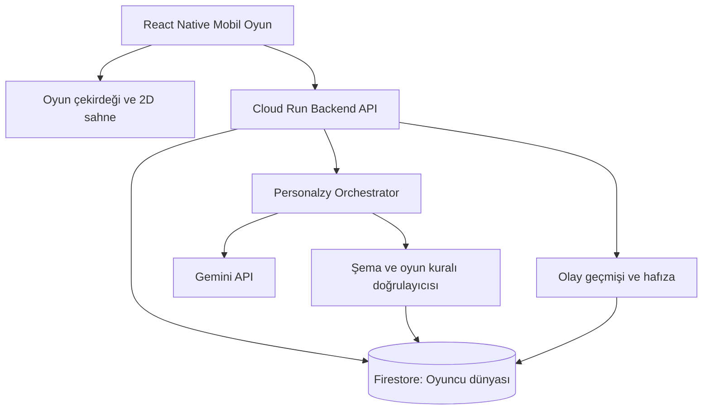

# Zombie Coder — Antigravity Project Initiation Plan

> **Belge türü:** Antigravity'ye verilecek ana proje talimatı ve uygulama planı  
> **Dil:** Türkçe  
> **Proje:** Zombie Coder  
> **Platform:** React Native CLI (bare React Native), Android öncelikli; iOS'a genişletilebilir  
> **Temel kaynaklar:** `idea.md`, `mechanics.md`, `technic.md`  
> **Öncelik:** Çalışan, test edilebilir küçük bir oyun çekirdeği; ardından kişiselleştirme

## 1. Antigravity'ye proje tanıtımı

Zombie Coder, dört yıllık yazılım mühendisliği eğitim sürecini oyunlaştıran, 2D yaşam simülasyonu ile mühendislik düşüncesini birleştiren bir mobil oyundur. Oyuncu üniversiteye başlayan bir yazılım mühendisliği öğrencisini yönetir. Amaç yalnızca kod yazdırmak değil; **problem çözme, kod okuma, sistem düşüncesi, teknik karar verme, AI ile çalışma ve AI agent'larını doğru yönlendirme/değerlendirme** becerilerini geliştirmektir.

Bu ürünün ayırt edici özelliği **kişisel olarak gelişen oyun dünyasıdır**. Her oyuncu aynı başlangıç haritası, mekânlar ve temel kurallarla başlar. Oyuncunun eylemleri, projeleri, iletişim biçimi, başarıları, zorlandığı noktalar ve gün sonu değerlendirmeleri ilerledikçe görevler, diyaloglar, karakter ilişkileri ve öğrenme fırsatları kişiye özgü hâle gelir.

**Kritik sınır:** “Kendini geliştiren oyun” ifadesi, AI'ın uygulama kaynak kodunu kendi kendine değiştirmesi, yeni native özellikler yüklemesi veya kontrolsüz kod çalıştırması demek değildir. Sabit oyun çekirdeği + veri odaklı içerik + oyuncuya özel dünya durumu + Personalzy AI + doğrulama katmanı kullanılacaktır. Oyuncuların farklı deneyim yaşaması için her defasında yeni mobil sürüm yayımlanması gerekmemelidir; fakat yeni motor yetenekleri, native özellikler, güvenlik yamaları ve mağaza gereklilikleri gerektiğinde uygulama güncellemesi kaçınılmazdır.

## 2. Belgelerin görevleri ve önceliği

Antigravity kod yazmadan önce aşağıdaki dört belgeyi eksiksiz okumalıdır:

1. **`idea.md`:** Ürünün vizyonu, eğitim yaklaşımı, mekânları ve oyuncu deneyimi.
2. **`mechanics.md`:** Günlük döngü, görevler, kişisel dünya, Personalzy, ilişkiler, hafıza ve içerik üretimi.
3. **`technic.md`:** Teknoloji mimarisi, veri modeli, AI servisleri, güvenlik ve teknik uygulama ilkeleri.
4. **`plan.md` (bu belge):** Başlangıç kapsamı, bağlayıcı proje kararları, geliştirme sırası, kabul kriterleri ve çalışma talimatları.

**Çelişki çözüm kuralı:** Ürün fikrinin anlamı için `idea.md`, oyun davranışları için `mechanics.md`, genel mimari için `technic.md` esas alınır. Bu belgede açıkça yapılan güncel kararlar (özellikle **Expo kullanılmaması**, mevcut **React Native CLI + Android emülatör iş akışı** ve **zorunlu gün sonu günlüğü**) önceki belgelerdeki farklı önerilerin yerini alır. Geri kalan gerçek çelişkilerde varsayım yapmadan kullanıcıya kısa seçenekler sun.

## 3. Ürün hedefleri

### 3.1. Dört yıllık eğitim yolculuğu

- Oyuncu birinci sınıf yazılım mühendisliği öğrencisi olarak başlar.
- Oyun ilerledikçe eğitim yılları, dersler, sınavlar, projeler ve mesleki problemler derinleşir.
- Eğitim içeriği yalnızca programlama sözdizimine değil, mühendislik yaklaşımına dayanır.
- Oyuncu AI'dan çözüm istemeyi, gelen yanıtı okumayı, doğrulamayı, test etmeyi, yanlışları tespit etmeyi ve agent'lara doğru görev tanımlamayı öğrenir.
- Başarılı, zorlanan, sık sık hata yapan, bazı günler hiçbir şey yapmayan veya motivasyonu düşen oyuncuların hepsi geçerli oyuncu yolculuklarıdır. Oyun yalnızca “başarılı öğrenci” senaryosuna göre tasarlanmamalıdır.
- Dört yılın gerçek zaman karşılığı ve dönem süreleri henüz kesin değildir; MVP'de birinci sınıfın kısa bir dilimi temsil edilir.

### 3.2. Ana mekânlar

**Üniversite:** Dersler, sınavlar, quizler, öğretim görevlileri, arkadaşlar, mühendislik problemleri ve akademik görevler. Oyuncunun ders başarısı ve öğrenme biçimi sonraki fırsatları etkiler.

**Ev:** Oyuncunun ödev yaptığı, kişisel projeler ve yan görevler geliştirdiği, bilgisayarındaki dijital çalışma alanını kullandığı merkezdir. Evde çalışma odası ve yatak odası bulunur.

**Yatak / gün sonu:** Yatak günün kapanış noktasıdır. Oyuncu yatmaya çalıştığında **gün sonu günlüğünü tamamlamak zorundadır**; günlük tamamlanmadan bir sonraki güne geçilemez. Oyuncu hiçbir aktivite yapmamış olsa bile kısa bir değerlendirme sunulur. Günlük soruları oyuncunun gününe, gelişimine ve önceki yanıtlara göre çeşitlenir; her gün aynı sorular ve aynı sonuçlar tekrarlanmamalıdır. Zorunluluk günlük adımını tamamlamaktır; hassas kişisel açıklama yapmak değildir. Oyuncu “bugün paylaşmak istemiyorum” gibi bir seçenekle minimum değerlendirmeyi tamamlayabilir. Bu da geçerli bir sinyal olarak işlenir, cezalandırılmaz.

**Spor salonu:** Fiziksel aktivite, motivasyon, sosyal ilişkiler ve iletişim dinamiklerinin yaşandığı mekândır. Düzenli katılım ve olumlu etkileşim, karakterlerin oyuncuya yaklaşımını zaman içinde daha tanıdık ve sıcak kılabilir. Oyuncunun iletişim tarzı diyalogların tonunu etkileyebilir: örneğin oyuncu samimi konuşuyorsa, ilişki düzeyi ve bağlam uygun olduğunda NPC'ler de daha samimi olabilir. Ancak AI, oyuncunun her ifadesini körlemesine taklit etmemeli; karakterlerin kendine özgü kişiliklerini, sosyal sınırlarını ve saygılı iletişimi korumalıdır. “Canım, nasılsın?” gibi hitaplar ancak oyuncu tercihi, NPC ilişkisi ve bağlam uygunsa kullanılmalıdır.

**İlerideki sosyal alanlar:** Yeni karakterler, etkinlikler ve ilişkiler için genişleme alanlarıdır; ilk MVP kapsamına zorunlu değildir.

### 3.3. Oyunun temel günlük döngüsü

1. Oyuncu uyanır; günün durumu ve fırsatları görüntülenir.
2. Üniversite, ev, spor salonu veya uygun başka bir mekânda zaman geçirir.
3. Görevleri yapabilir, yarım bırakabilir, yardım alabilir veya hiçbir şey yapmamayı seçebilir.
4. Evdeki bilgisayarda proje/ödev/yan görevlerle çalışabilir.
5. Yatağa gider ve **zorunlu günlük değerlendirmesini** tamamlar.
6. O günün somut olayları, günlük yanıtları ve geçmiş bağlam birlikte değerlendirilir.
7. Personalzy, kurallara uygun görev/diyalog/öğrenme önerileri hazırlar.
8. Sonraki gün başlar; oyuncunun kişisel dünyası tutarlı biçimde devam eder.

## 4. Personalzy: yaşayan kişisel oyun sistemi

Personalzy bir sohbet penceresinden ibaret değildir. Oyuncunun davranışlarına göre oyun içeriğini uyarlayan, ancak temel oyun kurallarına müdahale etmeyen bir AI katmanıdır.

### 4.1. Girdiler

- Oyuncunun açık tercihleri ve hedefleri.
- Oyun içi eylemler, görev ve sınav sonuçları.
- Yardım isteme, AI çıktısını sorgulama, test etme ve proje kararları.
- Gün sonu günlüğü ve isteğe bağlı serbest metin.
- NPC etkileşimleri ve ilişkilerin geçmişi.
- Mevcut dünya durumu ve oyuncunun öğrenme seviyesi.

### 4.2. Çıktılar

- Yeni görev önerileri ve uyarlanmış zorluk.
- Kısa, tutarlı NPC diyalogları.
- Oyuncuya özgü öğrenme önerileri.
- Proje gereksinimleri, kod okuma ve agent becerisi görevleri.
- `design.md` gibi oyun içi kişisel tercih dosyaları için öneriler.
- Gün sonu kısa değerlendirme ve sonraki gün için anlamlı değişiklikler.

### 4.3. Kişiselleştirme ilkeleri

- Oyuncuya kesin kişilik etiketleri yapıştırma.
- Başarısızlık ve pasif günler için sürekli aynı ceza/görev döngüsünü üretme.
- Geçmiş olayları unutup karakterlerin ilişki düzeyini aniden değiştirme.
- AI tahminlerini oyuncunun onaylanmış tercihleri gibi kaydetme.
- Her eylem için Gemini çağırma; yalnızca anlamlı anlarda çalıştır.
- Düşük riskli içerik otomatik sunulabilir; kalıcı ve önemli değişikliklerde onay al.
- AI üretimi başarısız olursa oyun ilerlemesi bloke olmamalı; doğrulanmış şablon/fallback içeriğe dön.

### 4.4. Zorunlu günlük için örnek davranışlar

| Oyuncunun günü | Günlük yaklaşımı | Sonraki güne olası etki |
|---|---|---|
| Hiçbir şey yapmadı | “Bugün nasıl geçti? Yarın küçük bir adım ister misin?”; paylaşmama seçeneği | Düşük eşikli, farklı alternatifler |
| Sınavda başarısız oldu | Hangi kısımda zorlandığını yargılamadan sor | Farklı açıklama, küçük uygulama veya tekrar seçeneği |
| AI kodunu anlamadan kullandı | Kodun hangi bölümünü anlamadığını sor | Kod okuma ve test etme görevi |
| Başarılı proje tamamladı | Ne işe yaradığını ve nasıl doğruladığını sor | Bir üst seviye mühendislik kararı |
| Spora düzenli gitti | Sosyal ve fiziksel ilerlemeyi kısa değerlendir | NPC'lerle ilişkide kademeli sıcaklık |
| Yoruldu veya motivasyonu azaldı | Kısa, isteğe bağlı yanıtlar | Daha hafif ve farklı görev alternatifleri |

**Tekrara düşmeme kuralı:** Sistem son günlük soru tiplerini, yakın tarihli görevleri ve öneri sonuçlarını izlemeli; aynı soru/ödevin arka arkaya gelmesini önleyen doğrulanabilir kurallar kullanmalıdır. Tamamen rastgelelik değil, bağlama uygun çeşitlilik hedeflenir.

## 5. Teknik altyapı — bağlayıcı kararlar

### 5.1. React Native CLI, Expo yok

Bu proje **bare React Native CLI + TypeScript** ile geliştirilecektir. **Expo, Expo Router, Expo Go, EAS Build veya Expo tabanlı yeni proje iskeleti kullanılmayacaktır.** React Native CLI ile uyumlu bağımlılıklar tercih edilecektir.

Kullanıcının bilgisayarında Android SDK, emülatör ve gerekli geliştirme ortamı hâlihazırda çalışmaktadır. Android Studio GUI kullanımını zorunlu tutma; mevcut SDK ve AVD kurulumundan yararlan. Yeni Android SDK/AVD kurulumunu kullanıcı istemedikçe yapma.

Kullanıcının mevcut iş akışı:

```bash
# Terminal 1: Android emülatörünü başlat
npm run emulator

# Terminal 2: Metro bundler'ı başlat
npm run start

# Terminal 3: Android debug build ve yükleme
npm run android
```

**Terminoloji düzeltmesi:** `npm run start` burada **Metro bundler** çalıştırır; Expo çalıştırmaz. `npm run android` React Native Android derleme/kurulum akışıdır.

Antigravity önce mevcut `zombie-coder` klasörünü incelemeli; çalışır bir proje varsa yeniden oluşturmamalı, mevcut scriptleri veya Gradle ayarlarını gereksiz yere değiştirmemelidir. Proje henüz yoksa bare React Native CLI iskeleti oluşturup yukarıdaki scriptleri çalışır hâle getirmelidir.

### 5.2. Önceki React Native projesi yalnızca referans

Kullanıcının önceki mobil uygulaması `aksiyonsoft-bilinkidea-mobile` için kullandığı `package.json`, komut yapısı ve çalışma alışkanlığı **referans alınabilir**. Ancak:

- Önceki projenin bütün bağımlılıklarını Zombie Coder'a topluca kopyalama.
- `@aksiyonsoft-bilinkidea/*` gibi proje özel paketlerini ekleme.
- `scripts/run-metro.cjs`, `scripts/run-android.cjs`, `scripts/run-emulator.cjs` gibi dosyaların Zombie Coder içinde var olduğunu varsayma; gerekiyorsa bu projeye uygun şekilde oluştur.
- `patch-package`, `overrides`, `vendor` ve eski workaround'ları ihtiyaç kanıtlanmadan taşıma.
- React Native, React, CLI, Gradle, Kotlin, JDK, Skia ve Reanimated sürümlerini **birbiriyle uyumlu** seç; önceki projedeki sürümleri körlemesine sabitleme.
- Script adları kullanıcıya tanıdık kalsın: `emulator`, `start`, `android`, `lint`, `type-check`, `test`.

### 5.3. Önerilen uygulama teknolojileri

- **React Native CLI + TypeScript:** Mobil istemci.
- **React Native Skia:** 2D sahne, sprite/harita çizimi; önce mevcut RN sürümüyle uyumluluğunu doğrula.
- **React Native Reanimated:** Animasyon; Skia ile uyumlu sürüm seç.
- **React Native Gesture Handler:** Dokunmatik kontroller.
- **React Navigation:** Menü, ayarlar ve oyun dışı ekranlar.
- **Zustand veya küçük bir eşdeğer:** UI/oturum durumu; gereksiz state kütüphanesi çoğaltma.
- **Firebase Authentication + Cloud Firestore:** Oyuncu hesabı ve kişisel dünya durumu.
- **Google Cloud Run üzerinde Node.js/TypeScript API:** Yetkili oyun işlemleri, AI orkestrasyonu, doğrulama.
- **Gemini API:** Personalzy'nin çalışma zamanı modeli; anahtar yalnızca backend'de.
- **Google Secret Manager:** Servis sırları.

**Not:** Bu bir başlangıç önerisidir. `technic.md` ile karşılaştır, mevcut proje yapısına göre en az müdahaleli uygulanabilir çözümü seç. İlk oynanabilir prototip için Firebase veya Gemini hesabı hazır olmasa bile yerel mock veriyle ilerle.

## 6. Google ekosistemi kullanımı ve dış araçların savunması

Google araçları geliştirme sürecinin merkezinde olmalıdır:

| Araç | Görev |
|---|---|
| **Google Antigravity** | Ana geliştirme, kod üretimi, test, planlama ve agent iş akışları |
| **Gemini / uygun Argon modeli** | Mimari analiz, kod inceleme, karmaşık mühendislik problemleri; erişim durumuna göre |
| **Google AI Studio / Playground** | Gemini promptları, yapılandırılmış çıktı, maliyet ve kalite denemeleri |
| **Google Stitch** | Mobil UI/UX taslakları ve ekran prototipleri |
| **NotebookLM** | Eğitim kaynakları, araştırmalar, tasarım kararları ve teknik belgeler için kaynak temelli çalışma |
| **Firebase / Google Cloud** | Üretim ortamı kimlik, veri, API ve AI altyapısı |

Google AI Pro aboneliği **otomatik olarak sınırsız Gemini API kredisi veya üretim backend kapasitesi anlamına gelmez**. API fiyatları, kotalar ve Argon/model erişimi kullanılan ürüne göre doğrulanmalıdır. Antigravity, gerçek ücretli servis kurulumundan önce kullanıcı onayı almalıdır.

Google dışı araçlar için kısa savunma:

- **React Native:** Kullanıcının zorunlu mobil geliştirme tercihi ve mevcut uzmanlığıdır; Android/iOS için tek TypeScript kod tabanı sağlar.
- **React Native Skia:** React Native'in standart bileşenleri özel 2D oyun sahnesi için yeterli değildir; yüksek performanslı 2D çizim sağlar.
- **Reanimated / Gesture Handler / React Navigation:** React Native mobil etkileşim, animasyon ve ekran akışı için gerekli ekosistem kütüphaneleridir.
- **Node.js / TypeScript:** React Native ile ortak dil, backend'de şema paylaşımı ve Cloud Run üzerinde kontrollü API geliştirme sağlar.
- **Git / npm / Jest / ESLint:** Sürüm kontrolü, paket yönetimi ve kalite güvencesi için standart geliştirme araçlarıdır.

Bu gerekçeleri proje sunumunda teknik karar olarak savun; yalnızca “popüler oldukları için” seçildiklerini söyleme.

## 7. Teknik mimari ve güven sınırları



**Güvenlik kuralları:**

1. Gemini API anahtarı istemciye koyulmaz.
2. Backend her oyuncu isteğini yetkilendirir; kullanıcı yalnızca kendi verisine erişebilir.
3. Firestore Security Rules ve backend doğrulaması birlikte tasarlanır.
4. AI çıktıları JSON şeması + oyun kuralları + dünya tutarlılığı kontrollerinden geçer.
5. Oyuncunun günlüğü ve proje metinleri güvenilmeyen girdidir; prompt injection oyun kurallarını değiştiremez.
6. AI'ın üretim ortamında sınırsız kod çalıştırma, keyfi dosya yazma veya doğrudan veritabanı değiştirme yetkisi olmaz.
7. AI kapalıyken temel hareket, sahne geçişi, görev şablonları ve gün kapatma akışı çalışmaya devam eder.
8. Oyuncu hafızasını görüntüleme, düzeltme ve silme yolları tasarlanır.
9. Oyuncuların sohbet ve günlük içerikleri model eğitimine veya dış araştırma araçlarına kendiliğinden aktarılmaz.

## 8. Veri odaklı dünya ve sürüm stratejisi

### 8.1. Ortak çekirdek

- Sabit haritalar, etkileşim türleri, hareket/çarpışma kuralları.
- Oyun zamanı, enerji, istatistik ve görev yaşam döngüsü.
- NPC kimlikleri ve başlangıç ilişkileri.
- İçerik şemaları, kabul kriterleri ve güvenlik sınırları.

### 8.2. Oyuncuya özel katman

- Dünya durumu ve olay geçmişi.
- Aktif/tamamlanmış görevler, projeler ve seçimler.
- NPC ilişki geçmişi ve iletişim tercihleri.
- Günlük kayıtları ve hafıza özetleri.
- Onaylanmış tercih dosyaları ve AI önerileri.

### 8.3. Örnek veri türleri

```ts
type WorldEvent = {
  id: string;
  playerId: string;
  type: string;
  occurredAt: string;
  payload: Record<string, unknown>;
};

type NpcRelationship = {
  npcId: string;
  familiarity: number;
  trust: number;
  lastInteractionAt?: string;
  recentTopics: string[];
};

type JournalEntry = {
  id: string;
  gameDay: number;
  answers: Array<{ questionId: string; answer: string }>;
  completedAt: string;
  reflectionStatus: 'pending' | 'ready' | 'fallback';
};
```

Bu tipler yalnızca yön gösterir; uygulamadan önce merkezi şema ve doğrulama oluştur.

### 8.4. İstemci sürümü değişmeden gelişme

Aynı mobil `1.0.0` istemcisi, backend'den yeni **mevcut şemalarla uyumlu** görevler, diyaloglar, proje verileri ve olaylar alabilir. Yeni native özellik, yeni render türü veya oyun motoru yeteneği gerekiyorsa istemci güncellemesi gerekir. Sunucu içeriği için `contentVersion`/`schemaVersion` ve geriye uyumluluk kontrolü kullanılmalıdır.

## 9. Oyun içi bilgisayar ve mühendislik görevleri

Bilgisayar ekranında en az şu alanlar planlanmalıdır:

- **University:** Ders, sınav ve ödevler.
- **My Projects:** Oyuncunun kendi projeleri ve yan görevleri.
- **Zombie Projects:** Eski/yarım kalmış kodu okuma, anlama, test etme ve teknik borç değerlendirmesi.
- **AI Memory:** Onaylı tercihler, hedefler ve güncel bağlam.

MVP'de gerçek bir IDE veya kontrolsüz kod çalıştırma altyapısı kurulmayacaktır. İlk görevler **kod okuma, çoktan seçmeli veya açıklamalı değerlendirme, hata bulma, çözüm karşılaştırma ve agent'a doğru talimat verme** üzerine kurulabilir. Daha sonra izole ve sınırlandırılmış bir kod çalışma ortamı ayrı fazda değerlendirilebilir.

## 10. Antigravity uygulama aşamaları

### Faz 0 — Keşif ve mevcut ortamı doğrulama

- Dört `.md` belgesini oku.
- `zombie-coder` klasöründe mevcut proje, `package.json`, Android SDK yolları, AVD, Metro ve Gradle yapılandırmasını incele.
- Çalışan kodu silme; mevcut yapıyı koru.
- Expo bulunuyorsa otomatik dönüşüm yapmadan durumu bildir; kullanıcı Expo istemiyor.
- Mimari kararları ve olası belge çelişkilerini kısa raporla.
- İlk sprint görevlerini kabul kriterleriyle sırala.

**Kabul:** Kullanıcı mevcut ortam ve ilk sprint planını görebilir.

### Faz 1 — Çalışan bare React Native Android iskeleti

- Var olan projeyi kullan veya yoksa bare RN CLI projesi oluştur.
- `npm run emulator`, `npm run start`, `npm run android` komutlarını doğrula.
- Minimal başlangıç ekranını emülatörde aç.
- `lint`, `type-check` ve temel testleri yapılandır.
- Android Studio GUI zorunluluğu olmadan komut satırıyla çalış.

**Kabul:** Android emülatöründe uygulama açılır; Metro bağlantısı ve debug build çalışır.

### Faz 2 — İlk oynanabilir 2D sahne

- Skia ile küçük, geçici varlıklar kullanan 2D harita.
- Tek karakter ve dört yönlü hareket.
- Çarpışma sınırları, etkileşim alanı ve kamera/viewport.
- En az bir kapı veya nesne etkileşimi.
- Animasyon ve FPS/performans gözlemi.

**Kabul:** Oyuncu haritada hareket eder, engellerin içinden geçmez ve bir nesneyle etkileşir.

### Faz 3 — Ev, üniversite ve gün döngüsü

- Ev ve üniversite sahneleri; spor salonu için temel yer tutucu/ilk etkileşim.
- Mekânlar arası geçiş.
- Basit enerji/zaman/öğrenme istatistikleri.
- Yatak etkileşimi ve zorunlu günlük akışı.
- Günlüğü tamamlamadan gün geçişini engelle.
- “Bugün paylaşmak istemiyorum” gibi minimum yanıtı geçerli kabul et.

**Kabul:** Oyuncu hiçbir görev yapmadan da günü tamamlayabilir; ancak günlük adımını atlayamaz.

### Faz 4 — Görevler, bilgisayar ve ilk mühendislik deneyimi

- Bilgisayar arayüzü ve proje klasörleri.
- En az üç görev türü: kod okuma, problem çözme, AI/agent değerlendirme.
- Görev başlatma, bırakma, teslim ve geri bildirim.
- Başarısızlık için cezalandırıcı olmayan alternatif yollar.

**Kabul:** Bir görev oyuncunun istatistiklerine ve sonraki önerilerine anlamlı etki eder.

### Faz 5 — Firebase ve oyuncuya özel kayıt

- Oyuncu kimliği, Firestore veri modeli ve yetki kuralları.
- Dünya durumu, günlük, görev ve olay geçmişinin saklanması.
- Yeniden girişte ilerleme yükleme.
- En az iki test hesabıyla veri izolasyonu.

**Kabul:** A oyuncusunun dünyası B oyuncusuna sızmaz.

### Faz 6 — Personalzy ve Gemini entegrasyonu

- Cloud Run API ve Gemini API entegrasyonu.
- Günlük + olay geçmişinden kısa bağlam oluşturma.
- Yapılandırılmış AI görev önerisi.
- Şema, kural ve tekrar kontrolü.
- AI yanıt vermezse hazır şablonlara dönüş.
- AI kullanım maliyeti ve rate limit gözlemi.

**Kabul:** Aynı başlangıçtan farklı kararlar alan iki oyuncuya farklı, tutarlı ve doğrulanmış öneriler sunulur.

### Faz 7 — Sosyal ilişkiler ve spor salonu

- NPC ilişki puanları ve etkileşim geçmişi.
- Tanışıklığa bağlı kademeli diyalog farklılaşması.
- Oyuncunun tercih ettiği üsluba bağlama uygun, saygılı adaptasyon.
- Tekrarlayan etkileşimlerde diyalog çeşitliliği.

**Kabul:** Düzenli giden oyuncu ile ilk kez gelen oyuncu aynı NPC'den farklı ama tutarlı karşılıklar alır.

### Faz 8 — Dört yıllık içerik yol haritası ve yayın hazırlığı

- Eğitim yılları ve dönemler için içerik şeması.
- Birinci sınıf içeriğinin genişletilmesi.
- Test, performans, erişilebilirlik, güvenlik, gizlilik ve maliyet kontrolü.
- Android yayın süreci; iOS için ayrı doğrulama.

**Kabul:** Oyun büyütülebilir bir veri modeliyle, güvenilir ilk sürüme hazırdır.

## 11. İlk sprint için kesin kapsam

**İlk sprintte yalnızca Faz 0–2 hedeflenir.** İlk günden bütün dört yıllık içeriği, Gemini sistemini ve Firebase altyapısını kurmaya çalışma.

İlk sprint teslimatı:

1. Mevcut projeyi koruyan, Expo'suz React Native CLI iskeleti.
2. Emülatörde çalışan uygulama.
3. Skia ile çizilmiş tek 2D harita.
4. Hareket eden karakter, çarpışma ve bir etkileşim.
5. Çalışan `emulator`, `start`, `android`, `lint`, `type-check`, `test` komutları (gerektiğinde scriptleri oluştur).
6. README: kurulum, komutlar, mevcut durum ve sonraki adımlar.
7. Antigravity uygulama raporu: değişen dosyalar, testler, ekran görüntüsü ve açık sorunlar.

## 12. Antigravity agent kuralları

- Önce planla, sonra uygula, ardından test et ve raporla.
- Kullanıcıya görünür çalışır çıktı üretmeden bir sonraki büyük faza geçme.
- Expo ekleme; Android Studio GUI kullanımını zorunlu kılma.
- Mevcut proje yapılandırmasını ve scriptlerini koru.
- Yeni bağımlılıklar için **neden gerekli** ve **Google merkezli tercihle nasıl uyumlu** olduğunu açıkla.
- Testleri geçmek için test silme, hatayı gizleme veya tip kontrollerini kapatma.
- Kullanıcı onayı olmadan ücretli Google Cloud kaynağı açma, faturalandırma etkinleştirme veya prod deploy yapma.
- Sırları ve servis hesaplarını repoya ekleme.
- Belirsiz ürün kararlarında birden fazla varsayımı kodlama; kısa seçenek sun.
- AI tarafından oluşturulan içeriği güvenilir kod veya komut olarak kabul etme.
- Oyun çekirdeği, AI orkestrasyonu ve veri saklama katmanlarını birbirinden ayır.
- Tamamlanan her fazda `README.md` ve ilgili teknik karar kayıtlarını güncelle.

## 13. İlk Antigravity mesajı (kopyala/yapıştır)

> Zombie Coder projesini başlatıyoruz. Proje köküne eklediğim `idea.md`, `mechanics.md`, `technic.md` ve `plan.md` dosyalarının tamamını oku. Bu bir **Expo'suz, bare React Native CLI + TypeScript** mobil 2D oyundur. Android emülatörüm ve SDK ortamım hazır. Mevcut `zombie-coder` projesi varsa silme veya yeniden oluşturma. Çalışma akışım `npm run emulator`, `npm run start` (Metro), `npm run android`. Önce kod tabanını ve teknik ortamı incele; belge çelişkilerini ve önerdiğin ilk sprint planını sun. Onaydan sonra yalnızca Faz 0–2'yi uygula: emülatörde çalışan uygulama, Skia 2D sahnesi, hareket eden karakter, çarpışma ve bir etkileşim. Yeni bağımlılıkların gerekçesini açıkla; her aşamada build/test yap ve sonuçları raporla. Firebase/Gemini ücretli servislerini henüz devreye alma. Oyunun temel hedefi, herkesin aynı dünyada başlayıp Personalzy ile zamanla farklı kişisel deneyimler yaşamasıdır.

---

**Ürün ilkesi:** Aynı başlangıç dünyası, farklı oyuncu yolculukları; kontrollü AI kişiselleştirmesi ve mühendislik odaklı öğrenme.
