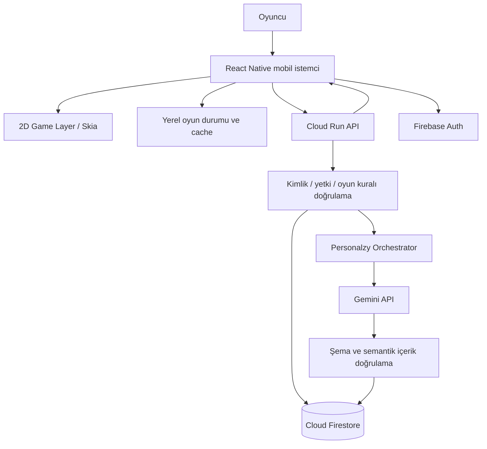

# Zombie Coder — Technical Architecture (`technic.md`)

> **Durum:** Antigravity'ye verilecek başlangıç teknik şartnamesi. Bu belge `idea.md` (ürün vizyonu) ve `mechanics.md` (oyun mekaniği) ile birlikte okunmalıdır. Çelişki halinde Antigravity varsayımda bulunmak yerine karar istemelidir.

## 1. Kesinleşmiş kararlar

- **Ürün:** Android öncelikli, iOS'a genişletilebilir, 2D mobil yaşam simülasyonu ve yazılım mühendisliği öğrenme oyunu.
- **Mobil:** **React Native CLI (bare React Native) + TypeScript**. **Expo kullanılmayacak.** Mevcut Android projesi korunacak; yeni proje oluşturulmayacak.
- **Geliştirme ortamı:** **Google Antigravity**. Google ekosistemi merkezde: Gemini, AI Studio, NotebookLM, Stitch, Playground ve uygun Google Cloud/Firebase servisleri.
- **Mevcut test akışı:** Proje kökünde `npm run emulator` → `npm run start` → `npm run android`. Bu komutlar korunacak; Antigravity `package.json` script'lerini ve Android yapılandırmasını incelemeden değiştirmeyecek.
- **Ana fikir:** Ortak oyun çekirdeği + oyuncu başına ayrı kalıcı dünya + Personalzy AI ile doğrulanmış, veri odaklı içerik üretimi.
- **İlk hedef:** Büyük oyunu tek seferde geliştirmek değil, mevcut projede çalışan ve emülatörde doğrulanabilen dikey kesit (vertical slice).

## 2. Var olan projeyi koruma kuralı

Antigravity ilk işlem olarak depo ağacını, `package.json`, `android/`, Gradle dosyalarını, Metro yapılandırmasını, TypeScript ayarlarını, navigasyonu ve mevcut kaynak kodunu incelemelidir. Mevcut çalışan altyapıyı sıfırlamak, Expo eklemek, `android/` klasörünü yeniden üretmek veya bağımlılıkları topluca yükseltmek **yasaktır**; ancak açık gerekçe ve kullanıcı onayıyla yapılabilir.

### Kullanıcının test rutini

Üç ayrı terminalde veya sırasıyla:

```bash
npm run emulator
npm run start
npm run android
```

`emulator` script'inin tam işlevi mevcut `package.json` üzerinden doğrulanmalıdır. Metro çalışırken Android build/install komutu kullanılacaktır. Gerekirse `adb devices`, Gradle hata çıktısı ve Metro logları incelenecektir. Script adları ve çalışma akışı değiştirilmemelidir. Emülatörün hazır olması, derlemenin başarılı olduğu anlamına gelmez: her aşama ayrı doğrulanır.

## 3. Önerilen teknoloji yığını

| Katman | Tercih | Gerekçe / sınır |
|---|---|---|
| Mobil uygulama | React Native CLI + TypeScript | Mevcut kurulumla uyumlu, Expo gerektirmez |
| 2D çizim | `@shopify/react-native-skia` **uyumluluk doğrulanırsa** | 2D harita, sprite ve sahne çizimi; React Native ile uyumlu harici kütüphane |
| Animasyon | `react-native-reanimated` **uyumluluk doğrulanırsa** | Akıcı hareket ve animasyon |
| Dokunma | `react-native-gesture-handler` | Dokunmatik kontrol ve etkileşim |
| Navigasyon | Mevcut navigasyon; yoksa React Navigation | Var olan yapıyı koru |
| Yerel durum | Zustand veya mevcut state çözümü | Küçük ve anlaşılır istemci durumu; yeni bağımlılık gerekçelendirilmeli |
| Kimlik | Firebase Authentication | Google ekosistemi, oyuncu hesapları |
| Kalıcı veri | Cloud Firestore | Oyuncuya özel dünya, görev, olay ve hafıza |
| Dosyalar | Cloud Storage for Firebase | Gerekli medya ve proje dosyaları |
| Sunucu | Cloud Run üzerinde Node.js + TypeScript | Yetkili oyun mantığı ve Gemini çağrıları |
| AI | Gemini API (sunucudan) | Personalzy, görev ve diyalog üretimi |
| Şema | JSON Schema / Zod | AI çıktısı ve API girdisi doğrulama |
| Gizli bilgiler | Google Cloud Secret Manager | API anahtarlarını istemciden uzak tutma |
| Gözlemlenebilirlik | Google Cloud Logging; uygun olduğunda Crashlytics | Hata ve maliyet takibi |

**Google dışı araç gerekçesi:** React Native kullanımı ürün gereksinimidir; Android SDK, Metro, Gradle, Skia, Reanimated, Gesture Handler, TypeScript ve gerektiğinde React Navigation/Zustand mobil uygulamanın teknik altyapısıdır. NotebookLM, Stitch veya Gemini bunların yerine mobil çalışma zamanı sağlamaz. Sunumda bu ayrım açıkça savunulacaktır. Unity/Unreal/Expo ve başka AI sağlayıcıları ilk sürümde kullanılmayacaktır.

**Uyumluluk şartı:** Antigravity, React Native sürümü, Android Gradle Plugin, Kotlin, JDK ve seçilen native paketlerin uyumluluk matrisini kontrol etmeden kurulum yapmayacak. Özellikle Skia ve Reanimated sürümleri mevcut RN sürümüyle doğrulanacaktır. Paketlerin sürümleri `package-lock.json` ile sabitlenecek.

## 4. Google araçlarının görev dağılımı

| Araç | Kullanım | Üretim oyununa doğrudan bağımlı mı? |
|---|---|---|
| **Antigravity** | Kod yazma, refactor, test, terminal, planlama, hata analizi | Hayır; geliştirme aracı |
| **Gemini** | Teknik analiz, fikir ve içerik tasarımı | Gemini API üzerinden yalnızca backend |
| **Gemini / Argon** | Hesapta erişilebiliyorsa karmaşık kod ve mimari inceleme | Hayır; belirli model adı zorunlu bağımlılık değil |
| **Google AI Studio / Playground** | Prompt, yapılandırılmış çıktı, model ve maliyet denemeleri | Hayır; laboratuvar |
| **NotebookLM** | Oyun tasarımı, React Native ve öğrenme kaynaklarının araştırılması | Hayır; bilgi tabanı, oyuncu hafızası değil |
| **Stitch** | Onboarding, HUD, bilgisayar, günlük, görev ekranı taslakları | Hayır; çıktılar RN bileşenlerine uyarlanır |
| **Firebase** | Auth, Firestore, Storage | Evet |
| **Cloud Run** | API ve AI orkestrasyonu | Evet |

**Abonelik notu:** Google AI Pro üyeliği, Antigravity/Gemini kullanım hakları ile üretim Gemini API tüketimini otomatik olarak aynı bütçede birleştirmez. API kotaları, faturalandırma, bölge ve model erişimi Google konsollarında ayrıca doğrulanmalıdır. “Argon” adının ilgili hesap/üründe kullanılabilirliği doğrulanmadan zorunlu model olarak kodlanmamalıdır. Model seçimi yapılandırılabilir olmalıdır.

## 5. Mimari



### 5.1. Mobil istemci

Harita, karakter, dokunmatik kontrol, HUD, görevler, evdeki bilgisayar, günlük ve AI sohbet arayüzünü çalıştırır. Yüksek frekanslı hareket/animasyon durumunu React bileşen state'inden ayırır. İstemcide API anahtarı veya Firebase Admin yetkisi tutulmaz.

### 5.2. Oyun çekirdeği

Zaman, enerji, konum, çarpışma, etkileşim, görev durumu ve gün bitişi gibi deterministik kurallar AI'dan bağımsız tanımlanır. AI yalnızca izin verilen içerik ve parametreler için **öneri** üretir; oyun motoru kaynak kodunu değiştirmez.

### 5.3. Backend

İlk aşamada tek modüler Cloud Run servisi yeterlidir. Firebase ID token doğrulaması, oyuncu veri izolasyonu, görev geçişleri, AI çağrıları, şema/kurallar doğrulaması ve olay kaydı backend sorumluluğundadır. Firestore istemci erişimi varsa Security Rules ayrıca uygulanır; Admin SDK'nın bu kuralları aşabildiği unutulmaz.

## 6. Oyun dünyası tasarımı

- **Sabit çekirdek:** Üniversite, ev (yatak odası/çalışma odası), spor salonu, temel karakterler ve kurallar.
- **Değişken içerik:** Oyuncuya özel görev, diyalog, proje, karakter tepkisi, öğrenme önerisi ve izin verilen dünya parametreleri.
- **İlk prototip:** Tek küçük 2D harita, tek karakter, dört yönlü hareket, duvar/nesne çarpışması, bir etkileşim noktası, basit sahne geçişi.
- **Harita biçimi:** İlk denemede basit JSON tile grid veya koordinatlı harita; performans ve tasarım denemesinden sonra kesinleştirilecek.
- **Oyun zamanı:** Gerçek saatten bağımsız oyun saati; hareket, görev ve dinlenme eylemleriyle ilerler. Gün bitirme yatak etkileşimiyle başlar.
- **Görev durumları:** `locked`, `available`, `active`, `submitted`, `completed`, `failed_or_retry` gibi açık geçişler; kesin durum makinesi testlerle sabitlenir.
- **Görünür istatistikler:** Kod okuma, sistem düşüncesi, problem çözme, motivasyon, enerji, sosyal bağlar.

## 7. Personalzy AI sistemi

### 7.1. Sorumlulukları

- Gün sonu günlüğünü oyun olaylarıyla birlikte değerlendirmek.
- Onaylı tercihleri ve geçici gözlemleri ayırmak.
- Kısa, yargılamayan geri bildirim vermek.
- Kod okuma, test ve mühendislik kararlarına yönelik görevler önermek.
- NPC diyalogları, proje adımları ve olay varyasyonları oluşturmak.
- Oyuncunun kişisel `design.md` gibi dosyaları için öneri taslakları üretmek.

### 7.2. Kontrol döngüsü

1. Oyuncu eylemi olay olarak kaydedilir.
2. Backend son olayları, aktif görevleri ve kısa hafıza özetini toplar.
3. Personalzy uygun prompt ve Gemini modelini seçer.
4. Model **yapılandırılmış JSON** önerisi üretir.
5. JSON Schema/Zod, yetki, zorluk, tutarlılık, güvenlik ve oyun kuralı kontrolleri çalışır.
6. Düşük riskli değişiklik uygulanabilir; önemli değişiklik oyuncu onayına gönderilir.
7. Uygulanan değişiklik versiyonlu dünya durumuna ve olay geçmişine kaydedilir.

### 7.3. Örnek öneri sözleşmesi

```json
{
  "kind": "task_proposal",
  "title": "Kodun İzini Sür",
  "difficulty": "beginner",
  "learningGoals": ["code_reading", "testing"],
  "acceptanceCriteria": ["Fonksiyonun davranışı açıklanmalı", "Bir test senaryosu hazırlanmalı"],
  "estimatedMinutes": 20,
  "requiresApproval": false
}
```

Bu örnek şema değildir; gerçek şema ve izinli değerler kodda tanımlanacaktır. Modelin JSON üretmesi içeriğin doğru veya güvenli olduğu anlamına gelmez.

### 7.4. Hafıza ilkeleri

- **Onaylı tercih:** Oyuncunun açıkça belirttiği veya doğruladığı bilgi.
- **Gözlem:** Eylemlerden çıkarılan, kesin olmayan ve değişebilir eğilim.
- **Özet:** Uzun geçmiş yerine modele gönderilen kısa ve ilgili bağlam.
- Her kayıt kaynak, zaman, doğrulama durumu ve gerektiğinde güven seviyesi içerir.
- Oyuncu kendi tercihlerini ve hafızasını görüntüleyip düzenleyebilir/silebilir.
- Her istekte tüm sohbet geçmişi modele gönderilmez.

### 7.5. Kod görevleri ve güvenlik

MVP'de oyuncunun yazdığı veya Gemini'nin ürettiği rastgele kod **cihazda veya üretim backend'inde çalıştırılmaz**. Kod okuma, test sonucu yorumlama, çoktan seçmeli hata ayıklama ve kontrollü senaryolarla başlanır. Gerçek kod çalıştırma sonraki aşamada gerekiyorsa izole sandbox, kaynak/zaman sınırı, ağ erişim kısıtları ve ayrı yürütme servisi tasarlanır.

## 8. Veri modeli (ilk taslak)

```text
gameContent/{version}/locations/{locationId}
gameContent/{version}/taskTemplates/{templateId}
gameContent/{version}/characters/{characterId}
users/{uid}/profile/main
users/{uid}/world/current
users/{uid}/stats/current
users/{uid}/tasks/{taskId}
users/{uid}/projects/{projectId}
users/{uid}/journal/{entryId}
users/{uid}/memory/preferences
users/{uid}/memory/observations/{observationId}
users/{uid}/memory/summaries/{summaryId}
users/{uid}/events/{eventId}
users/{uid}/aiProposals/{proposalId}
```

Dünya durumuna `schemaVersion`, `worldRevision`, `updatedAt` alanları eklenir. Olaylar benzersiz `eventId` ile idempotent işlenir. Oyuncuların verileri UID bazında izole edilir. Gereksiz kişisel bilgi (telefon, doğum tarihi vb.) başlangıçta toplanmaz.

## 9. API sözleşmesi (öneri)

```text
GET    /v1/world
POST   /v1/world/actions
GET    /v1/tasks
POST   /v1/tasks/:id/submit
GET    /v1/projects
POST   /v1/projects
POST   /v1/journal
GET    /v1/memory
PATCH  /v1/memory/preferences
POST   /v1/personalzy/reflect
POST   /v1/personalzy/propose-task
POST   /v1/personalzy/proposals/:id/approve
GET    /v1/sync
```

API'ler kullanıcı token'ı, şema doğrulaması, rate limit, hata kodları ve işlem tekrarına dayanıklılık ile geliştirilir. AI yanıtı gecikirse istemci bekleme durumunu gösterir; işlem kimliğiyle tekrar sorgulama yapılabilir.

## 10. Önerilen depo yapısı

Mevcut proje yapısı incelenerek **minimum müdahaleyle** uyarlanmalıdır. Bu dizin ağacı zorunlu yeniden düzenleme talimatı değildir.

```text
zombie-coder/
  idea.md
  mechanics.md
  technic.md
  README.md
  package.json
  android/
  ios/                  # Mevcutsa korunur
  src/
    game/
      engine/
      maps/
      entities/
      collision/
      interactions/
    screens/
    features/
      onboarding/
      computer/
      tasks/
      journal/
      personalzy/
    components/
    state/
    services/
    assets/
  backend/
    src/
      modules/
        auth/
        world/
        tasks/
        journal/
        memory/
        personalzy/
        validation/
      prompts/
      schemas/
      index.ts
  docs/
    decisions/
    tests/
```

## 11. Çevrimdışı kullanım ve senkronizasyon

Temel hareket ve önbelleğe alınmış sahneler bağlantı kesildiğinde çalışabilir. AI içerik üretimi internet gerektirir. Yerel eylemler kuyruklanabilir; her olay benzersiz ID taşır. Sunucu doğrulaması ve `worldRevision` çakışmaları yönetir. İlk sürümde tam offline AI veya çok cihazlı eşzamanlı gerçek zamanlı oynanış hedeflenmez.

## 12. Güvenlik, gizlilik ve maliyet

- Gemini API anahtarları yalnızca backend/Secret Manager'da.
- Firebase ID token doğrulama, App Check (uygun entegrasyonla), Firestore Security Rules ve backend yetkilendirme.
- Günlük metinleri ve oyuncu dosyaları **güvenilmeyen girdi** kabul edilir; prompt injection ile sistem talimatı veya yetki değiştirilemez.
- Günlükler, kişisel hafıza ve projeler için veri minimizasyonu; kullanıcıya görüntüleme, düzeltme ve silme imkânı.
- AI çağrıları için oyuncu başına limit, timeout, retry, token bütçesi ve günlük maliyet takibi.
- Ücretsiz/abonelik limitleri, Gemini API faturalandırması ve Cloud Run/Firestore maliyetleri ayrı değerlendirilir.
- API ve içerik şemaları sürümlenir; istemci `1.0.0` kalsa bile sunucu bakımı/güvenlik güncellemesi yapılabilir. **Sıfır güncelleme garantisi verilmez.**

## 13. Test stratejisi

- **Mobil:** Jest + React Native Testing Library (mevcut kuruluma uyumluysa), hareket/çarpışma ve durum makinesi testleri, Android emülatörde manuel senaryo.
- **Backend:** API doğrulama, kullanıcı izolasyonu, idempotency, Firestore Rules emulator testleri.
- **AI:** JSON şeması, çelişkili hafıza, yanlış zorluk, uygunsuz içerik, onay akışı ve prompt injection regresyon testleri.
- **Performans:** Düşük/orta seviye Android emülatör profillerinde sahne akıcılığı, bellek ve yükleme süresi gözlemi.
- **Tamamlanma ölçütü:** Kod değişikliği + ilgili testler + başarılı `npm run android` + emülatör doğrulaması. Başarısız test saklanmaz.

## 14. Uygulama yol haritası

### Faz 0 — İnceleme ve plan
- Üç `.md` dosyasını oku; mevcut repo, script ve Android altyapısını incele.
- Mimari uyumluluk ve risk raporu çıkar.
- Expo olmadığını doğrula; mevcut build akışını koru.
- İlk dikey kesit için görev planı ve kabul kriterleri hazırla.

### Faz 1 — Oynanabilir 2D prototip
- Tek küçük harita, tek karakter, hareket, çarpışma, kamera/sabit görünüm, etkileşim noktası.
- Android emülatörde oynanabilir demo.

### Faz 2 — Yaşam döngüsü
- Ev, üniversite, temel geçişler, zaman, enerji, yatakla gün bitirme.
- Gün sonu günlüğü (önce AI olmadan).

### Faz 3 — Bilgisayar ve görevler
- Bilgisayar arayüzü; University, My Projects, Zombie Projects kavramsal alanları.
- İlk kod okuma görevi ve deterministik değerlendirme.

### Faz 4 — Google backend
- Firebase Auth, Firestore, Cloud Run API, kullanıcı bazlı dünya kaydı ve senkronizasyon.
- İki oyuncu hesabıyla veri izolasyonu testi.

### Faz 5 — Personalzy MVP
- Gemini API, yapılandırılmış çıktı, hafıza özeti, gün sonu değerlendirmesi.
- Doğrulanmış görev önerisi ve onay akışı.

### Faz 6 — Kişisel dünya evrimi
- Oyuncu tercihleri (`design.md`), farklı görevler/diyaloglar, olay geçmişi, karakter tepkileri.
- Aynı başlangıçtan farklı iki oyuncu için tutarlı farklılaşma testi.

### Faz 7 — Kalite ve yayın hazırlığı
- Güvenlik, performans, maliyet, veri silme, hata izleme, Android dağıtım testi; iOS ayrı doğrulama.

**MVP başarı ölçütü:** Oyuncu emülatörde karakterini hareket ettirir, ev/üniversite arasında geçiş yapar, bilgisayarda bir kod okuma görevini tamamlar, yatağa gidip günlüğü doldurur ve Personalzy'nin doğrulanmış sonraki görev önerisini görür. Yeniden girişte ilerleme korunur.

## 15. Antigravity çalışma kuralları

1. Üç belgeyi sırayla oku: `idea.md` → `mechanics.md` → `technic.md`.
2. Önce mevcut repo ve `package.json` script'lerini incele. Çalışan yapıyı bozma.
3. **Expo kurma, `expo init` çalıştırma, Expo Router ekleme, React Native projesini yeniden oluşturma.**
4. Her faz öncesi kısa plan, dosya değişiklikleri, bağımlılıklar ve kabul kriterlerini sun.
5. Google dışı her yeni araç/kütüphane için teknik gerekçe ve sunumda savunulabilir açıklama ekle.
6. Native bağımlılık eklemeden önce RN/Android uyumluluğunu doğrula.
7. Büyük kod üretimi yerine küçük, test edilen artımlı değişiklikler yap.
8. Kullanıcının `npm run emulator`, `npm run start`, `npm run android` akışını koru.
9. Test veya build çalıştırılamıyorsa bunu açıkça belirt; başarı iddia etme.
10. AI modelini ve API anahtarlarını istemciye gömme.
11. AI'ın oyun kaynak kodunu veya üretim verisini sınırsız değiştirmesine izin verme.
12. Her faz sonunda çalışan demo, test sonucu, değişen dosyalar ve sonraki adımı raporla.
13. Tasarım ve teknik kararlarda belirsizlik varsa varsayımını açıkla ve kritik karar için kullanıcı onayı iste.

### Antigravity'ye verilecek ilk görev

> `idea.md`, `mechanics.md` ve `technic.md` dosyalarını oku. Mevcut React Native CLI projemi analiz et; Expo kullanma ve yeni proje oluşturma. `package.json` içindeki `npm run emulator`, `npm run start`, `npm run android` akışını koru. Mevcut Android/Gradle/Metro yapılandırmasını doğrula. Önce mimari ve fazlara bölünmüş uygulama planını çıkar. Sonra yalnızca Faz 1 için tek harita, hareket edebilen karakter, çarpışma ve etkileşim noktası içeren küçük bir 2D prototip geliştir. Yeni kütüphaneler için uyumluluk ve Google dışı kullanım gerekçesi sun. Build/test sonuçlarını raporla; çalışmayan özelliği tamamlanmış sayma.

## 16. Sunumda teknoloji savunması

**Neden Google?** Gemini, AI Studio, NotebookLM, Stitch, Antigravity, Firebase ve Cloud Run araştırma, tasarım, geliştirme ve üretim süreçlerinde birbirini tamamlar. AI modeli sunucuda yönetildiği için güvenlik ve maliyet kontrolü sağlanır.

**Neden React Native?** Mobil oyun gereksinimi ve mevcut çalışan Android geliştirme ortamı bunu belirliyor. Google'ın araştırma ve AI araçları React Native'in yerini tutan bir mobil UI framework değildir.

**Neden Skia/Reanimated gibi Google dışı paketler?** 2D sahne çizimi ve akıcı animasyon için React Native ile uyumlu özel teknik yetenek gerekir. Alternatifleri ve paket uyumluluğunu değerlendirdikten sonra kullanılır.

**Neden Expo yok?** Mevcut bare React Native projesi, Android emülatörü, Metro ve Gradle build akışı zaten çalışıyor. Yeni bir framework katmanı eklemek bu aşamada gerekli değil.

**Neden Firebase/Cloud Run?** Oyuncu bazlı kalıcı dünya, kimlik doğrulama ve güvenli Gemini API erişimi için yönetilen Google altyapısı.

## 17. Açık tasarım kararları

- Dikey mi yatay mı ekran? İlk prototipten önce karar verilecek.
- Pixel art mı, modern 2D mi? Stitch tasarımları ve performans denemesiyle seçilecek.
- Tile-based harita mı, serbest koordinatlar mı? İlk sahne prototipinden sonra kesinleşecek.
- Oyunun dört yıllık üniversite yolculuğu hangi zaman sıkıştırma kuralıyla işleyecek?
- iOS build ortamı ne zaman hazırlanacak? Android öncelikli geliştirme iOS'un test edildiği anlamına gelmez.
- Gemini model adları, API maliyet limiti ve üretim bölgesi Google konsolunda doğrulanacak.

## 18. Resmî kaynaklar

- React Native: https://reactnative.dev/docs/getting-started
- React Native Skia: https://shopify.github.io/react-native-skia/
- Reanimated: https://docs.swmansion.com/react-native-reanimated/
- Google Antigravity: https://antigravity.google/
- Gemini API: https://ai.google.dev/gemini-api/docs
- Google AI Studio: https://aistudio.google.com/
- NotebookLM: https://notebooklm.google.com/
- Stitch: https://stitch.withgoogle.com/
- Firebase: https://firebase.google.com/docs
- Firestore: https://firebase.google.com/docs/firestore
- Cloud Run: https://cloud.google.com/run/docs

---

**Son prensip:** Tek mobil uygulama ve ortak oyun çekirdeği; oyuncuya özel dünya, hafıza ve doğrulanmış AI içerikleri. AI kişisel deneyimi geliştirir; güvenilir oyun kurallarını veya uygulama kaynak kodunu kontrolsüz biçimde değiştirmez.
